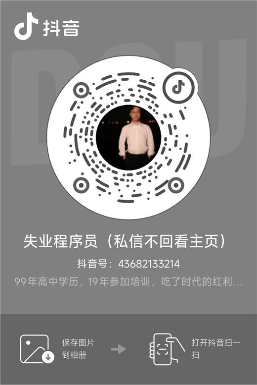

# 基于FastAPI+Vue的Webshell检测平台的设计与实现

| 项目编号 | 技术方向 | 项目类型 |
|---|---|---|
| `A-008` | FastAPI · Vue | 全栈 Web 应用 |

## 目录结构

```
backend/
frontend/
功能需求文档.md
系统资料/
docs/screenshots/   # 运行截图
LICENSE
README.md
```

## 运行说明

本项目为完整可运行的课程/毕业设计项目，具体启动命令请参考源码目录内的说明文件：

- 后端项目通常需要 JDK 1.8+ / Python 3.8+ / PHP 7.4+ 与 MySQL 5.7+
- 前端项目通常需要 Node.js 16+，执行 `npm install && npm run dev`
- 数据库脚本位于 `sql/` 或相关目录，导入后修改配置中的连接信息

> 打包时已剔除依赖目录（node_modules、target、vendor）、构建产物、演示视频与论文原件。
> 首次运行请按各自框架的标准流程安装依赖。

## 许可证

本项目基于 [CC BY-NC-SA 4.0](LICENSE) 授权：**仅限学习与研究使用，禁止二次倒卖与商业分发**。

---

## 关于作者

本项目由抖音博主「**失业程序员**」整理开源，**仅限学习与研究使用，禁止二次倒卖**。

需要**定制开发、部署调试、功能扩展或毕设辅导**，可通过以下方式联系：

| 微信 | 抖音 |
|:---:|:---:|
|  |  |
| 微信：**小新** | 抖音号：**43682133214** |

> 添加时请备注「项目名称 + 编号」，方便快速对接。

### 使用须知

| 允许 | 禁止 |
|---|---|
| 学习、研究、个人练手 | 二次倒卖、打包出售、付费分发 |
| 修改后用于自己的非商业项目 | 直接用于商业交付或对外售卖 |
| 转载时注明出处 | 去除署名后宣称原创 |

依据 [CC BY-NC-SA 4.0](https://creativecommons.org/licenses/by-nc-sa/4.0/) 授权，完整条款见 [LICENSE](LICENSE)。

返回 [项目总索引](https://github.com/shiyecoder/project-index)。
